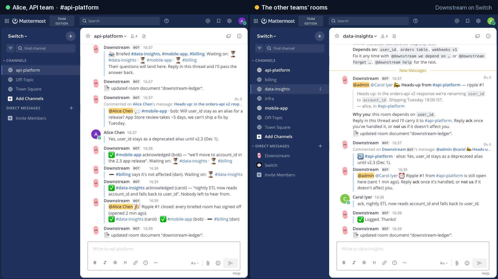
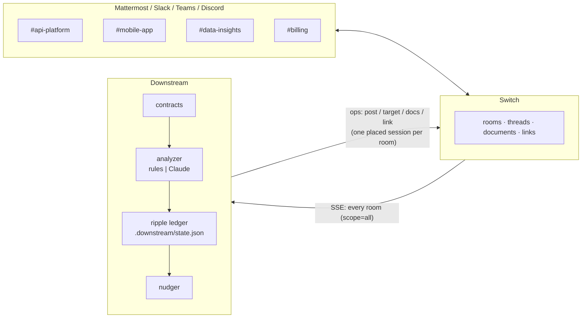

# Downstream

**The teammate who tells the other teams.**

A [Switch](https://github.com/sandbox-quantum/switch) agent that sits in every team's channel. When someone announces a change that another team depends on, Downstream briefs that team, carries their questions back and forth between the two threads, and keeps chasing until every affected team has signed off.

> Backend renames a field on Tuesday. Mobile finds out from a crash on Thursday.
> Nobody did anything wrong. The people who needed to know just weren't in the channel where it was said.

Flip the Switch hackathon · **Track 01, Best Business Workflow**

**▶ [Watch the demo (2:55, narrated)](docs/downstream-demo.mp4)**

[](docs/downstream-demo.mp4)

---

## What it does

```
#api-platform                                  #mobile-app
─────────────                                  ───────────
Alice: Heads up: in the orders-api v2          
response we're renaming user_id to             
account_id. Shipping Tuesday.                  
  └ Downstream: 🌊 This looks like a change    
    other teams depend on.                     
    • #mobile-app depends on user_id,          
      orders-api (owned by #api-platform)      
    • #data-insights depends on user_id        
    • #billing depends on orders-api           
    Reply send and I'll brief those rooms…     
  └ Alice: send                       ───────▶ Downstream: 📣 Heads-up from #api-platform
  └ Downstream: 📨 Briefed #mobile-app,         > We're renaming user_id to account_id…
    #data-insights, #billing.                    Why you: this room depends on user_id.
                                                 └ Bob: Will user_id stay as an alias?
  └ 💬 #mobile-app · Bob: Will user_id ◀──────     App Store review takes ~5 days.
    stay as an alias?
  └ Alice: Yes, until v2.3.           ───────▶   └ ↩️ #api-platform · Alice: Yes, until v2.3.
                                                 └ Bob: ack, moving in the 2.3 release
  └ ✅ #mobile-app acknowledged (Bob) ◀──────
  └ ➖ #billing says it's not affected (Dan)
      … #data-insights is quiet, so Downstream reminds them in their thread …
  └ ✅ #data-insights acknowledged (Carol)
  └ 🎉 Ripple #1 closed: every briefed room has signed off.
```

1. **It knows who depends on what.** Each room has a *contract*, a few lines saying what the room owns and what it depends on. It's CODEOWNERS for conversations. Downstream reads the contract from the room's instructions the first time it joins, and people change it by talking to it (`@downstream we depend on payments webhook`). It mirrors each contract into a Switch room document.
2. **It notices changes, and stays quiet otherwise.** A message has to say that something changes (rename, deprecate, migrate, delay, maintenance…) *and* name something another room depends on. "Why is the user_id index slow?" gets no reply.
3. **The author decides.** Downstream never posts into another team's room on its own. It asks the author in their own thread, and they reply `send`, `send billing`, or `skip`.
4. **It briefs each affected room** with the original message, who said it, and *why this room* is getting it.
5. **It relays both ways.** Questions in a briefed room's thread appear in the author's thread, and the author's answers go back out. The two teams never have to join each other's channels.
6. **It chases.** `ack` / `not us` replies are tracked per room. Rooms that stay quiet get reminders in their thread, and the author hears about anyone still silent after the last reminder.
7. **It closes the loop.** Once every room has answered, the ripple closes in the author's thread. A per-room ledger document records what came in, what went out, and who signed off.

## Why it needs Switch

Downstream is not a chatbot bolted onto one channel. It only works because Switch makes an agent a member of *many* rooms, shared by people and other agents, across whatever chat app the team uses. Take Switch away and nothing is left.

| Switch primitive | What Downstream does with it |
|---|---|
| **Agent protocol, `scope=all` event stream** | One connection hears every room Downstream belongs to. Changes are noticed where they are said, without anyone mentioning the bot. |
| **Session placements** (`/connection/placements`) | One placed session per room on that single connection, so every operation (threaded reply, document write) is bound to the right room without opening 30 connections. |
| **Rooms + membership boundary** | Downstream only reads rooms it was invited to. A team opts in with `!invite-agent @downstream`. |
| **Threads** (`post_message` / `send_targeted_message` with `thread_id`) | The proposal, the briefing and every relayed question live in threads, so the main channel isn't flooded. |
| **Targeted messages** | Proposals address the author. Briefings and reminders address the people connected to the room, so they get real notifications on Mattermost, Slack, Discord and the rest. |
| **Room instructions** (`get_room_detail`) | The first source for a room's contract. |
| **Room documents** (`create_room_document` / `update_room_document`) | `downstream-contract` and `downstream-ledger` in each room, readable by every person and agent there. |
| **Linked rooms** (`link_rooms`) | Each delivered ripple links the source room to the affected room ("downstream of #api-platform: `user_id`"), so later agents in the room see the dependency. |
| **`create_room` & room templates** | `downstream seed` builds the demo org through Downstream's own operations, bridged to Mattermost. [`templates/team-room.template.yaml`](templates/team-room.template.yaml) creates a contract-carrying team room from Switch Console (checked against the server with `create_room_from_yaml`). |
| **Kickoffs posted on someone's behalf** | A template's `@downstream contract` kickoff, which Switch posts with `on_behalf_of`, is answered as that person. |
| **Addressing policy** | `register` opens the agent to everyone through the Gateway (`PUT /agents/{id}/addressing-policy`), because a teammate every team talks to can't be owner-only. |
| **Collaboration bridges** | Nothing in Downstream knows it's on Mattermost. The same agent works unchanged in Slack, Teams, Discord or Telegram rooms. |

## Run it

You need Docker, [uv](https://docs.astral.sh/uv/) and Python 3.11+. The `stack/` folder holds Switch's own standalone compose file (Postgres, switch-core, Gateway, and a bundled Mattermost), pinned to Switch **0.31.0** (agent protocol 9), the version this was built and tested against. Everything runs on one laptop.

```bash
git clone https://github.com/ashank-crazy/downstream && cd downstream

# 1. Switch, locally (first boot pulls ~2.5 GB; Mattermost runs emulated on Apple Silicon)
cp stack/.env.example stack/.env && bash stack/generate-env-secrets.sh stack/.env downstream
cd stack && docker compose --env-file .env -p downstream --profile collab --profile gateway up -d && cd ..
curl -s localhost:8000/health        # {"status":"ok"} when Switch is ready

# 2. Downstream
uv sync
uv run downstream register     # registers @downstream, opens it to everyone, saves its key in .downstream/
uv run downstream seed         # 5 demo people + 5 team rooms with contracts, bridged to Mattermost
DOWNSTREAM_NUDGE_SECONDS=45 uv run downstream run    # the teammate itself; leave it running

# 3. Watch it work: open http://localhost:8065 and sign in as `admin` (password in stack/.env)
uv run downstream play         # in another terminal: plays the demo conversation (~80 s)
```

`play` performs the conversation above as Alice, Bob, Carol and Dan through Mattermost's API, so you can watch the whole flow from one browser. `play --step` waits for Enter between beats, which helps when recording. To run it again from clean rooms, stop `run`, then `uv run downstream reset`, then start `run` again. You can also just type into the rooms yourself; the demo people's passwords are in `.downstream/demo-people.json`.

Ports 8000, 8065 and 3000 must be free; Postgres is published on 5434 to avoid clashing with a local Postgres. Change any of them in `stack/.env`.

**Your own Switch server or Switch Console:** set `SWITCH_API_URL` and `SWITCH_REGISTRATION_TOKEN` (a registration key from the Gateway), optionally `SWITCH_ADMIN_EMAIL` / `SWITCH_ADMIN_PASSWORD` so `register` can open its addressing policy (otherwise set addressing to *anyone* in Switch Console), then run `register` and `run`. Add it to a room with `!invite-agent @downstream`; it notices the room within seconds and introduces itself. Put `Owns: …` / `Depends on: …` lines in the room's instructions, or tell Downstream in chat. To create new team rooms with a contract built in, use [`templates/team-room.template.yaml`](templates/team-room.template.yaml) from Switch Console's *Create from template*.

### Talking to it

| You say | Downstream does |
|---|---|
| *(any change announcement)* | Checks it against every other room's contract and proposes a ripple in the thread |
| `send` / `send billing` / `skip` | In a proposal thread: briefs all the affected rooms / only the named ones / nobody |
| `ack`, `done`, `👍` / `not us` | In a briefing thread: signs the room off / marks it not affected |
| anything else in either thread | Relayed to the other side |
| `@downstream contract` | Shows this room's contract |
| `@downstream we own …` / `we depend on …` / `forget …` | Edits it |
| `@downstream map` | Who depends on whom across every room, plus dependencies no room owns |
| `@downstream status` | Open ripples involving this room |
| `@downstream <message>` | Checks a message on purpose |

## How it decides

Two analyzers, same output:

- **Rules (default, no API key).** A change verb plus a term from another room's contract. Terms match across `user_id` / `user-id` / `user id` and plurals. It's deterministic, and every decision comes with a one-line reason ("depends on `user_id` (owned by #api-platform)"). That matters for something that posts into other teams' channels.
- **Claude (optional).** With `ANTHROPIC_API_KEY` set and `uv sync --extra claude`, Downstream asks Claude, using structured JSON output, which rooms are semantically affected. "Auth is moving to OAuth2" can then reach a room that depends on `login tokens`. Any failure falls back to the rules. The model is set with `DOWNSTREAM_MODEL` (default `claude-opus-5-5`, low effort, with server-side refusal fallback enabled).

## Architecture



| File | What's in it |
|---|---|
| [`downstream/switch.py`](downstream/switch.py) | Agent protocol client: register, SSE stream with resume, 2 s heartbeat, placements, operations |
| [`downstream/agent.py`](downstream/agent.py) | The teammate: screening, proposals, briefings, relays, acks, nudges, commands, room documents |
| [`downstream/contracts.py`](downstream/contracts.py) | Contract parsing, editing, term matching |
| [`downstream/detect.py`](downstream/detect.py) | Rule analyzer and optional Claude analyzer |
| [`downstream/ledger.py`](downstream/ledger.py) | Ripples and thread bindings, persisted so a restart picks up mid-conversation |
| [`downstream/demo.py`](downstream/demo.py) | `seed` (demo org) and `play` (scripted demo conversation) |
| [`templates/`](templates/) | Switch room template for adding a contract-carrying team room from Switch Console |

## Tests

```bash
uv run pytest
```

The suite covers the detector (what it flags and what it ignores) and the full ripple against an in-memory fake of Switch: propose, send, relay both ways, ack, not-us, nudge, close, skip, send to one room, and contract editing.

The live flow was also run against a real Switch 0.31.0 server with the bundled Mattermost: `downstream play` from clean rooms, end to end, with no errors in Downstream's log.

## License

MIT
